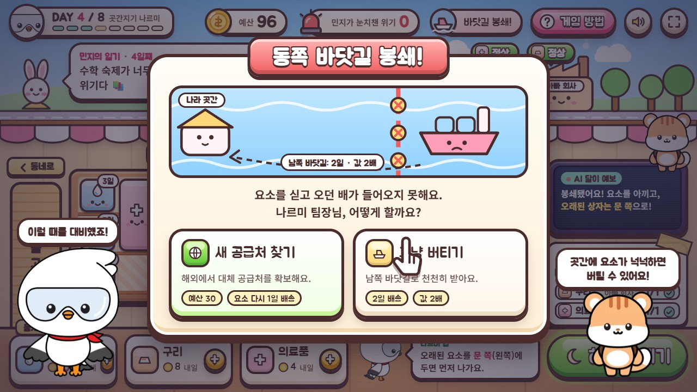
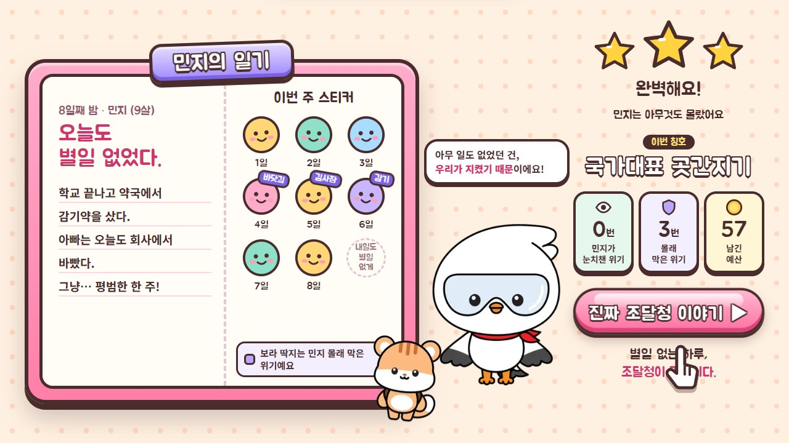

# 별일 없는 하루

**2026 조달청 AI 게임·콘텐츠 공모전 · AI 게임 부문 출품작** · 팀 별일없조

> 잘할수록 아무 일도 안 일어나는 게임! 나라 곳간을 지켜 민지의 평범한 하루를 지켜요.

**[▶ 브라우저에서 바로 하기](https://songnayeong.github.io/ordinary-day/)** · [시연영상·실행파일 내려받기](https://github.com/SongNayeong/ordinary-day/releases) · [기획서](docs/proposal.md)

조달청 나르미 팀장이 되어 8일 동안 나라 곳간(공공비축)을 지키는 퍼즐 시뮬레이션입니다. 요소·구리·의료품 상자를 선반에 쌓고, AI 달이의 예보를 보고 미리 주문하고, 바닷길 봉쇄 같은 사건을 막습니다. 곳간이 비면 버스가 서고 약국이 텅 비면서 동네 아이 민지의 일기가 바로 달라집니다. 끝까지 지켜 내면 이 게임의 바탕이 된 조달청의 실제 이야기(2021 요소수 대란 → 2026 위기 조기 대응)로 이어집니다.

| | |
|---|---|
|  |  |
|  |  |

## 실행하기

- **웹에서**: [songnayeong.github.io/ordinary-day](https://songnayeong.github.io/ordinary-day/)
- **내려받아서**: [Releases](https://github.com/SongNayeong/ordinary-day/releases)의 실행파일 zip을 풀고 `별일없는하루.html`을 더블클릭하세요. 크롬·엣지에서 설치나 인터넷 없이 열립니다. 그림·소리·글꼴이 모두 html 파일 하나에 들어 있어요.
- 한 판에 약 10분 걸립니다. 마우스나 터치로 상자를 끌어 놓는 것이 조작의 거의 전부예요.

## 개발

Node.js 18 이상만 있으면 됩니다. 외부 패키지가 없어서 `npm install`도 필요 없어요.

```bash
npm run dev       # http://localhost:5178 에서 src/ 미리보기
npm run build     # dist/index.html — 그림·글꼴을 넣은 배포용 한 파일
npm run fonts     # 새 글자를 썼을 때 부분 글꼴 다시 받기 (인터넷 필요)
npm run autodemo  # dist/autodemo.html — 1분 자동 시연 (시연영상 녹화용)
```

- `src/index.html`에 새 글자를 쓰면 글꼴에 그 글자가 없어서 빌드가 멈춥니다. `npm run fonts`를 먼저 돌리세요.
- `main`에 push하면 GitHub Actions가 빌드해서 GitHub Pages에 올립니다 (`.github/workflows/deploy-pages.yml`).

## 프로젝트 구조

```
├── src/                      게임 원본
│   ├── index.html            게임 전체 (HTML·CSS·JS 한 파일)
│   ├── assets/               캐릭터 그림 (나르미, 달이, 여우 김사장)
│   └── fonts/                게임에 쓰인 글자만 담은 부분 글꼴
├── scripts/                  빌드·글꼴·미리보기·자동 시연 스크립트
├── docs/
│   ├── proposal.md           기획서 (참가신청서 본문)
│   ├── contest-info.md       공모전 정보 정리
│   ├── screenshots/          게임 화면
│   └── first-guest/          「첫 손님」 기획 문서
├── prototypes/first-guest/   「첫 손님」 시제품 5종
└── .github/workflows/        GitHub Pages 자동 배포
```

## 만들면서 쓴 방법

- **한 파일, 오프라인 실행**: 공공기관 PC처럼 인터넷이 막힌 곳에서도 똑같이 보이도록 Google Fonts 링크를 없애고, 게임에 쓰인 글자(531자)만 담은 부분 글꼴을 data URI로 넣었습니다 (`scripts/fontsub.js`, `scripts/build.js`).
- **고정 무대 확대**: 1280×720 무대를 창 크기에 맞춰 확대해서, 어떤 화면에서도 배치가 같습니다. 본문은 16~17px, 주요 글씨는 19px 이상.
- **소리도 코드로**: 배경음악과 효과음을 외부 음원 없이 Web Audio로 직접 연주하고, 마스터 리미터로 소리가 찢어지지 않게 했습니다.
- **시연영상 자동 녹화**: 게임 함수를 그대로 불러 1분 동안 알아서 진행하는 스크립트(`scripts/autodemo.js`)를 붙이고, 헤드리스 크롬에서 그 탭만 녹화(getDisplayMedia + MediaRecorder)했습니다.
- **Jua 글꼴 세로 맞춤**: Jua는 줄 상자 가운데보다 약 0.089em 위에 그려집니다. 이름표·배지 안의 Jua 글씨는 위 패딩을 아래보다 크게 줘야 가운데로 보입니다.
- **튜토리얼**: 첫날은 스포트라이트와 손가락 안내로 6단계를 직접 해 보게 하고, [게임 방법] 카드 4장은 언제든 다시 볼 수 있습니다.

## 「첫 손님」 시제품

처음에는 조달청 **혁신제품 시범구매**(써 본 곳이 없는 새 기술을 나라가 처음 사 주는 제도)를 소재로 「첫 손님 — 나라가 처음 사주는 날」을 준비했습니다. 방향을 여러 번 바꾸며 만든 시제품들이 [`prototypes/first-guest/`](prototypes/first-guest/)에 있고, 기획 문서는 [`docs/first-guest/`](docs/first-guest/)에 있습니다.

| 시제품 | 내용 | 웹에서 |
|---|---|---|
| [`design-mockup`](prototypes/first-guest/design-mockup/) | 발명가 발표회 화면 디자인 체험 시안, 화면 12장, AI 그림 프롬프트 기록 | [열기](https://songnayeong.github.io/ordinary-day/prototypes/first-guest/design-mockup/) |
| [`play-version`](prototypes/first-guest/play-version/) | 네 계절 현장 미션 + 발표·조사·구매·기업 성장. 소스와 규칙 테스트 포함 | [열기](https://songnayeong.github.io/ordinary-day/prototypes/first-guest/play-version/) |
| [`village-3d`](prototypes/first-guest/village-3d/) | three.js 3D 마을을 걸어 다니며 주민 편지로 이어지는 사계절 퀘스트 (WebGL). 소스 포함 | [열기](https://songnayeong.github.io/ordinary-day/prototypes/first-guest/village-3d/) |
| [`card-battle`](prototypes/first-guest/card-battle/) | 카드 배틀·출동 배틀 실험판 | [카드](https://songnayeong.github.io/ordinary-day/prototypes/first-guest/card-battle/card-battle.html) · [출동](https://songnayeong.github.io/ordinary-day/prototypes/first-guest/card-battle/dispatch-battle.html) |
| [`adventure`](prototypes/first-guest/adventure/) | 나르미를 움직여 NPC와 대화하고 혁신기업을 키워 마을을 스마트시티로 만드는 어드벤처 (마지막 「첫 손님」 버전) | [열기](https://songnayeong.github.io/ordinary-day/prototypes/first-guest/adventure/) |

## 사용한 자료와 권리

- **나르미·달이 캐릭터 © 조달청**: 공모전에서 제공한 공식 캐릭터 이미지를 변형 없이 썼습니다. 이 저장소 밖에서 쓰려면 조달청 이용 규정을 확인하세요.
- **글꼴**: Jua, Noto Sans KR (SIL Open Font License 1.1)
- **three.js** (MIT License): village-3d 시제품에 사용, 라이선스 파일 동봉
- **AI 생성 그림**: 여우 김사장과 「첫 손님」의 배경·발명가 그림은 ChatGPT 이미지 생성으로 만들었습니다 (프롬프트는 `prototypes/first-guest/design-mockup/*-prompt*.json`).
- **실제 이야기 출처**: 조달청 보도자료, KDI 경제정보센터 (2026)
- 등장하는 회사·인물(민지, 김사장 등)과 게임 속 수치는 모두 가상입니다.

## 만든 사람

팀 **별일없조** (6명). 기획 방향과 재미·디자인 수정, 최종 검토는 팀이 정하고 AI로 구현했습니다.

- Claude (Claude Code): 기획 정리와 규칙 설계, 게임 코드, 화면 디자인과 SVG 그림, 대사, 자료 조사, 자동 플레이 테스트, 시연영상 녹화
- ChatGPT: 여우 김사장 그림
