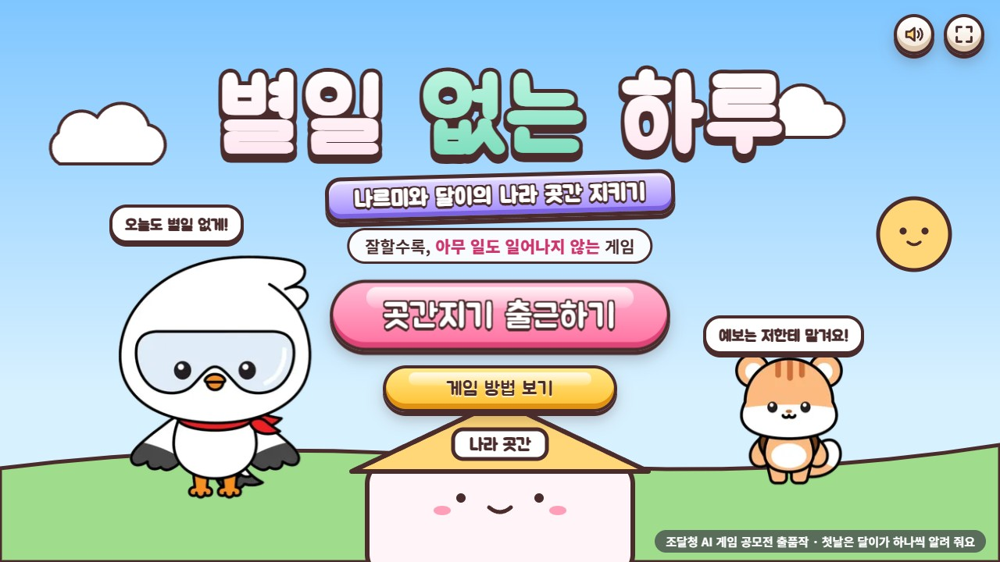

# 별일 없는 하루 · Ordinary Day

**2026 조달청 AI 게임·콘텐츠 공모전 (AI 게임 부문) 출품작** · 팀 별일없조

잘할수록 아무 일도 일어나지 않는 게임입니다.
조달청 나르미 팀장이 되어 8일 동안 나라 곳간(공공비축)을 지키는 퍼즐 시뮬레이션입니다. 요소·구리·의료품 상자를 선반에 쌓고, AI 달이의 예보를 보고 미리 주문하고, 바닷길 봉쇄 같은 사건을 막습니다. 곳간이 비면 버스가 서고 약국이 텅 비면서 동네 아이 민지의 일기가 바로 달라집니다.

| | |
|---|---|
|  |  |
|  |  |

## 바로 플레이

- **웹**: <https://songnayeong.github.io/ordinary-day/>
- **내려받아 실행**: [Releases](https://github.com/SongNayeong/ordinary-day/releases/latest)의 `ordinary-day-v1.0.zip`을 풀고 `별일없는하루.html`을 더블클릭하면 됩니다. 크롬·엣지에서 설치나 인터넷 연결 없이 실행됩니다.
- **시연영상**: [Releases](https://github.com/SongNayeong/ordinary-day/releases/latest)에서 바로 볼 수 있습니다 (1분 8초).

## 게임 소개

| 항목 | 내용 |
|---|---|
| 장르 | 시뮬레이션 (퍼즐 요소) |
| 플레이 시간 | 약 10분 (8일) |
| 목표 | 8일 동안 민지가 위기를 한 번도 눈치채지 못하게 하기 |
| 결과 | 민지의 일기, 별점(최대 3개), 칭호, 기록 → 버튼 하나로 조달청의 실제 이야기 |
| 조작 | 마우스·터치로 상자 끌어 놓기, 주문 카드와 [하루 보내기] 누르기 |
| 실행 환경 | PC·웹 (크롬, 엣지), 인터넷 연결 불필요 |

**하루의 흐름**: 아침 트럭 도착 → 상자 정리·주문 → [하루 보내기] → 밤에 동네가 필요한 만큼 가져감 → 결과 확인

**퍼즐 규칙**
- 밤에는 출고문 가까운 상자부터 나갑니다. 오래된 요소를 문 쪽에 둡니다.
- 요소는 3일이 지나면 굳어서 버려야 하고, 구리는 무거워 맨 아래 칸에만, 의료품은 세로 2칸을 차지합니다.
- AI 달이의 예보("이틀 뒤 바닷길이 막힐 확률 70%")를 보고 미리 쌓아 둡니다.
- 사건마다 새 공급처 찾기, 부정 거래 적발, 민관공동비축 등을 고릅니다.

첫날은 스포트라이트와 손가락 안내로 하나씩 직접 해 보며 배우고, [게임 방법] 카드 4장은 언제든 다시 볼 수 있습니다.

## 반영된 조달청 정책

| 게임 요소 | 실제 조달청 정책 |
|---|---|
| 나라 곳간 | 요소·구리 같은 핵심 물자를 미리 쌓아 두는 정부 비축사업(공공비축) |
| 바닷길 봉쇄 · 새 공급처 찾기 | 2026년 중동 정세 속 요소수 위기를 미리 알아채고 해외 대체 공급처를 확보한 대응 (2026 한국정책대상 대상) |
| 구리 비축으로 아빠 회사 지키기 | 비철금속을 비축해 중소기업에 공급하는 일 |
| 정책 카드 "민관공동비축" | 민간과 함께 비축 공간을 넓히는 정책 |
| AI 달이 예보 | AI로 위기를 미리 알아채는 지능형 전략비축 시스템(추진 중) |
| 김사장의 "되팔기" 제안 적발 | 공정한 비축물자 관리 |

게임이 끝나면 2021 요소수 대란 → 공급망 다변화·비축 확대 → 2026 위기 조기 대응 → 한국정책대상 대상 → AI 비축 시스템까지의 실제 이야기를 출처와 함께 보여 줍니다. 자세한 기획 의도는 [기획서](docs/proposal.md)에 있습니다.

## 개발

Node.js 18 이상만 있으면 됩니다. 외부 패키지가 없어 `npm install`은 필요 없습니다.

```bash
npm run dev       # http://localhost:5178 에서 src/ 미리보기
npm run build     # dist/index.html — 그림·글꼴을 넣은 배포용 한 파일
npm run fonts     # 새 글자를 썼을 때 부분 글꼴 다시 받기 (인터넷 필요)
npm run autodemo  # dist/autodemo.html — 1분 자동 시연 (시연영상 녹화용)
```

- `src/index.html`에 글꼴에 없는 새 글자를 쓰면 빌드가 멈춥니다. 이때는 `npm run fonts`를 먼저 실행합니다.
- `main`에 push하면 GitHub Actions가 빌드해 GitHub Pages에 배포합니다.

**기술**: Vanilla JS · HTML5 · CSS3 (게임 엔진·외부 라이브러리 없음), Web Audio로 직접 연주하는 배경음악·효과음, 게임에 쓰인 글자만 담은 부분 글꼴(531자)을 data URI로 넣은 한 파일 빌드

## 폴더 구성

| 폴더 | 내용 |
|---|---|
| `src/` | 게임 원본 (`index.html` 한 파일, 캐릭터 그림, 부분 글꼴) |
| `scripts/` | 빌드, 부분 글꼴 받기, 미리보기 서버, 자동 시연 |
| `docs/` | 기획서, 공모전 정보, 화면 이미지, 「첫 손님」 기획 문서 |
| `prototypes/first-guest/` | 처음 준비한 기획 「첫 손님」의 시제품 5종 |
| `.github/workflows/` | GitHub Pages 자동 배포 |

## 구현 메모

- **오프라인 실행**: 공공기관 PC처럼 인터넷이 막힌 곳에서도 똑같이 보이도록 Google Fonts 링크를 없애고 부분 글꼴을 파일 안에 넣었습니다 (`scripts/fontsub.js`, `scripts/build.js`).
- **고정 무대 확대**: 1280×720 무대를 창 크기에 맞춰 확대해 어떤 화면에서도 배치가 같습니다. 본문은 16~17px, 주요 글씨는 19px 이상입니다.
- **시연영상 자동 녹화**: 게임 함수를 그대로 불러 1분 동안 자동 진행하는 스크립트(`scripts/autodemo.js`)를 붙이고, 헤드리스 크롬에서 그 탭만 녹화(getDisplayMedia + MediaRecorder)했습니다.
- **Jua 글꼴 세로 맞춤**: Jua는 줄 상자 가운데보다 약 0.089em 위에 그려집니다. 이름표·배지 안의 Jua 글씨는 위 여백을 아래보다 크게 줘야 가운데로 보입니다.

## 「첫 손님」 시제품

처음에는 조달청 **혁신제품 시범구매**(써 본 곳이 없는 새 기술을 나라가 처음 사 주는 제도)를 소재로 「첫 손님 — 나라가 처음 사주는 날」을 준비했습니다. 방향을 여러 번 바꾸며 만든 시제품은 [`prototypes/first-guest/`](prototypes/first-guest/)에, 기획 문서는 [`docs/first-guest/`](docs/first-guest/)에 있습니다.

| 시제품 | 내용 | 웹에서 |
|---|---|---|
| [`design-mockup`](prototypes/first-guest/design-mockup/) | 발명가 발표회 화면 디자인 시안, 화면 12장, AI 그림 프롬프트 기록 | [열기](https://songnayeong.github.io/ordinary-day/prototypes/first-guest/design-mockup/) |
| [`play-version`](prototypes/first-guest/play-version/) | 네 계절 현장 미션 + 발표·조사·구매·기업 성장. 소스와 규칙 테스트 포함 | [열기](https://songnayeong.github.io/ordinary-day/prototypes/first-guest/play-version/) |
| [`village-3d`](prototypes/first-guest/village-3d/) | three.js 3D 마을을 걸어 다니며 주민 편지로 이어지는 사계절 퀘스트 (WebGL). 소스 포함 | [열기](https://songnayeong.github.io/ordinary-day/prototypes/first-guest/village-3d/) |
| [`card-battle`](prototypes/first-guest/card-battle/) | 카드 배틀·출동 배틀 실험판 | [카드](https://songnayeong.github.io/ordinary-day/prototypes/first-guest/card-battle/card-battle.html) · [출동](https://songnayeong.github.io/ordinary-day/prototypes/first-guest/card-battle/dispatch-battle.html) |
| [`adventure`](prototypes/first-guest/adventure/) | 나르미를 움직여 NPC와 대화하고 혁신기업을 키워 마을을 스마트시티로 만드는 어드벤처 | [열기](https://songnayeong.github.io/ordinary-day/prototypes/first-guest/adventure/) |

## 생성형 AI 활용

| 쓰는 곳 | 도구 |
|---|---|
| 기획 정리, 규칙 설계, 게임 코드, 화면 디자인과 SVG 그림, 대사·튜토리얼 문장, 자료 조사, 자동 플레이 테스트, 시연영상 녹화 | Claude (Anthropic, Claude Code) |
| 여우 "김사장" 캐릭터 그림, 「첫 손님」 배경·발명가 그림 | ChatGPT 이미지 생성 (OpenAI) |

기획 방향과 재미·디자인 수정 방향, 최종 검토는 팀이 정하고 AI로 구현했습니다. 그림 생성 프롬프트는 `prototypes/first-guest/design-mockup/*-prompt*.json`에 있습니다.

## 권리 안내

- 마스코트 나르미·달이의 권리는 조달청에 있습니다. 공모전에서 제공한 공식 캐릭터 이미지를 변형 없이 사용했습니다.
- 등장하는 회사·인물(민지, 김사장 등)과 게임 속 수치는 모두 가상입니다.
- 글꼴: Jua, Noto Sans KR (SIL Open Font License 1.1)
- three.js (MIT License): `village-3d` 시제품에 사용했으며 라이선스 파일을 함께 넣었습니다.
- 실제 이야기 출처: 조달청 보도자료, KDI 경제정보센터 (2026)

## 라이선스

이 저장소의 코드와 콘텐츠는 공모전 출품 목적으로 만들었으며, 별도의 오픈소스 라이선스를 지정하지 않았습니다. 글꼴·캐릭터 등 제3자 자료는 각 권리자의 라이선스를 따릅니다.
